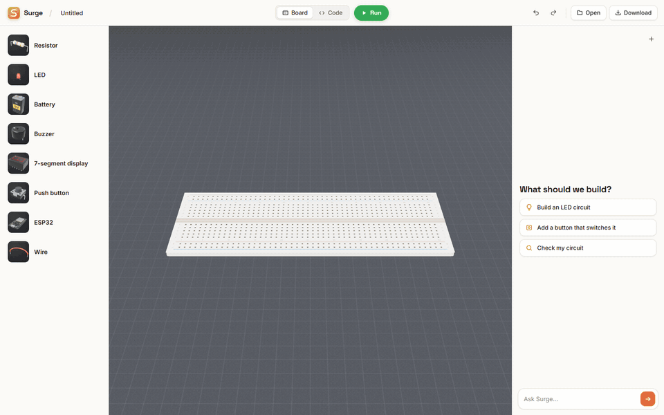
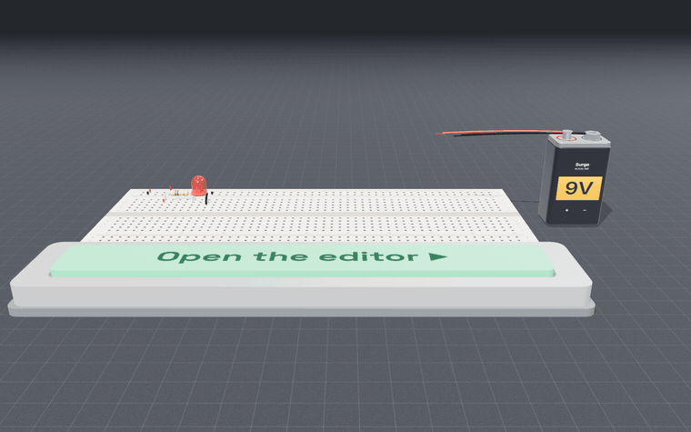
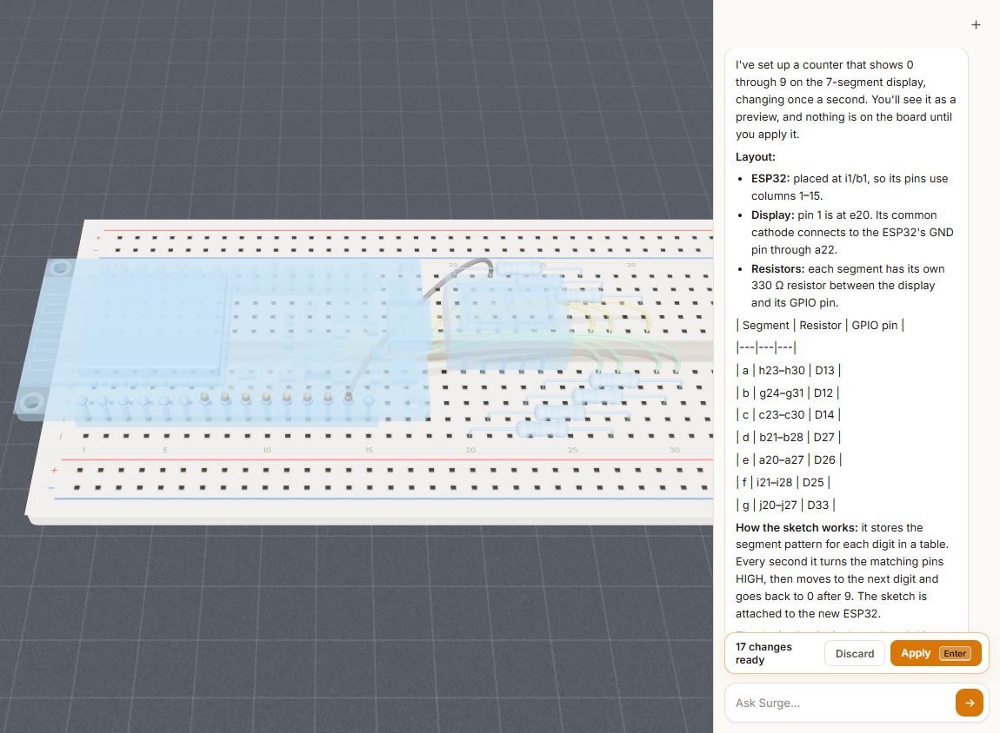
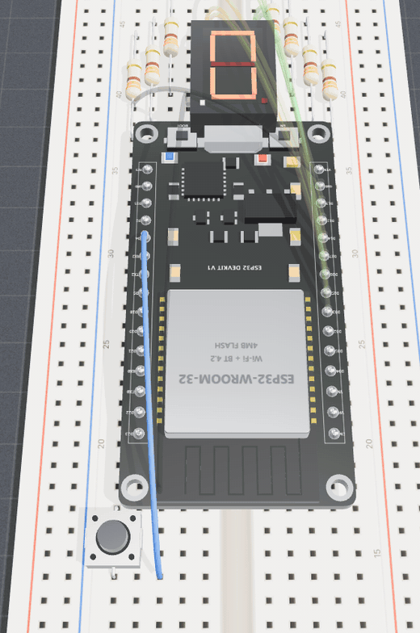
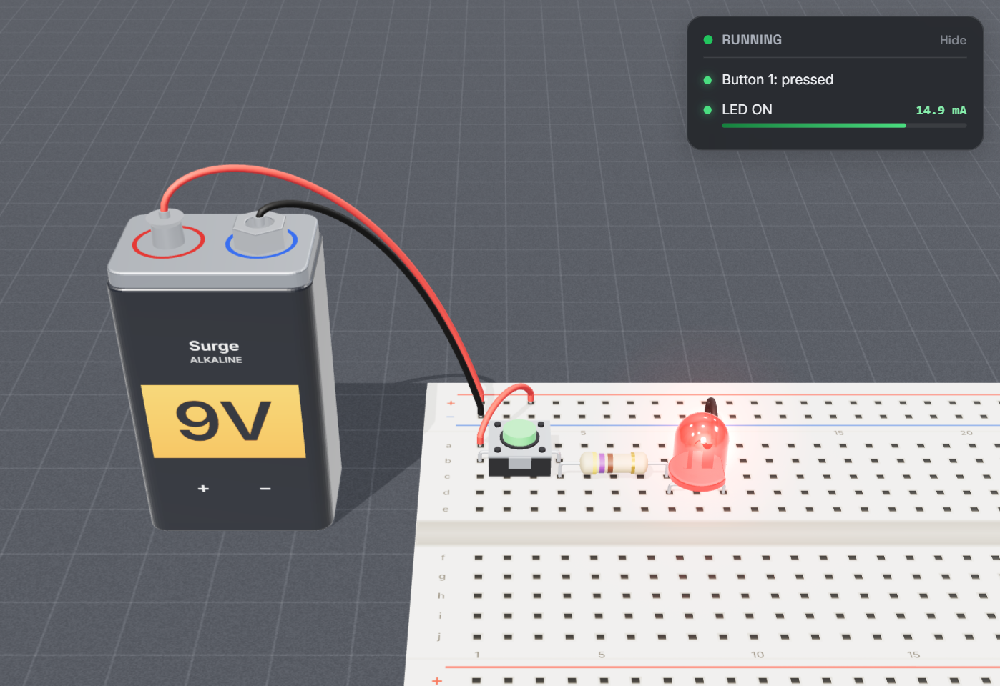
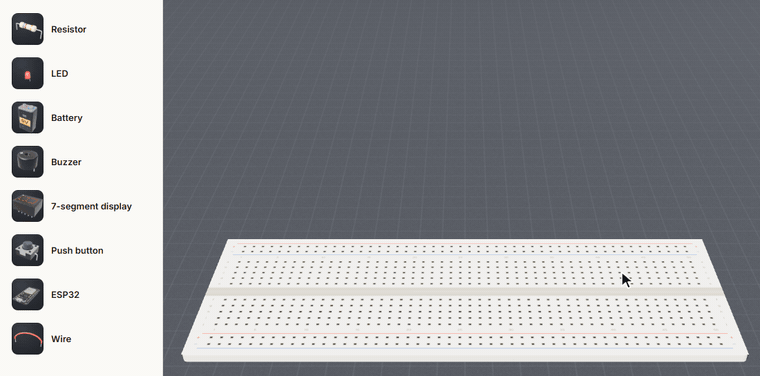
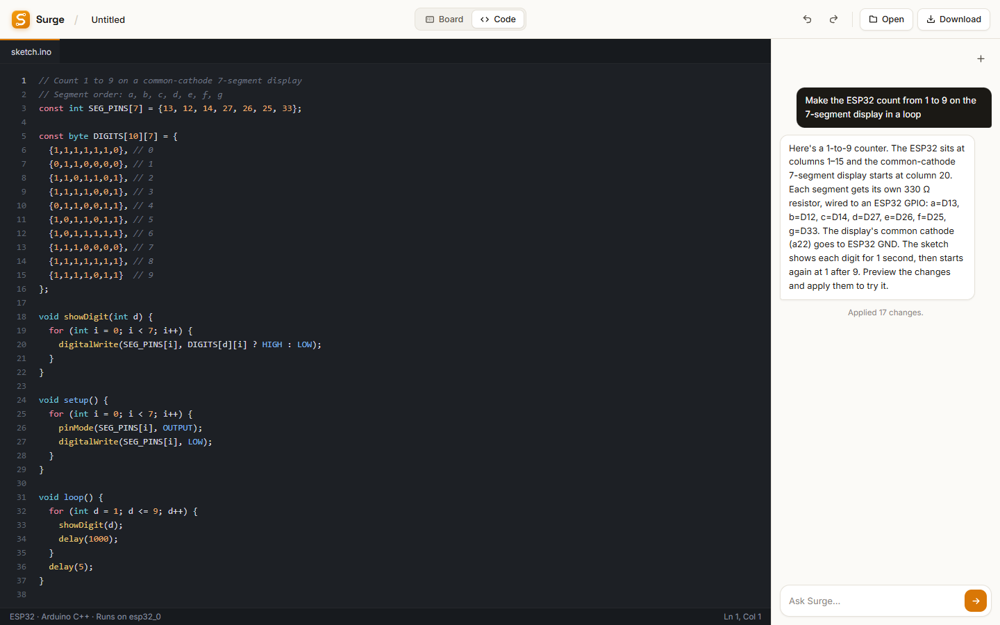

# Surge

<p align="center">
  
</p>

A 3D breadboard in the browser with an AI assistant built in. Describe a circuit, check the ghost preview, press Apply and Run.

The circuit simulates live, and an ESP32 runs the Arduino sketch the assistant wrote. Try it at **[surge-flow.web.app](https://surge-flow.web.app)**.

<p align="center">
  
</p>

## How it works

```
              "Make the ESP32 count from 1 to 9 on a 7-segment display"
                                         |
                                         v
                              +---------------------+
                              |     Surge chat      |
                              |  board state + ask  |
                              +---------------------+
                                         |
                                         v
                              +---------------------+
                              |     Chat model      |
                              | Claude Code, Codex, |
                              | Gemini, Claude API  |
                              +---------------------+
                                         |  actions (JSON schema)
                                         v
                              +---------------------+
                              |  Server validation  |
                              | sockets, pins, caps |
                              +---------------------+
                                         |
                                         v
                              +---------------------+
                              |    Ghost preview    |
                              | blue fits, red clash|
                              +---------------------+
                                  |             |
                               Apply         Discard
                                  v
              +---------------------------------------------+
              |                  Breadboard                 |
              |  parts, wires, sketch.ino in the Code tab   |
              +---------------------------------------------+
                         |                         |
                         v                         v
              +---------------------+   +---------------------+
              |   Sketch runtime    |   |     DC solver       |
              | JSCPP, virtual      |-->| nodal analysis,     |
              | clock, GPIO 3.3 V   |   | LED diode models    |
              +---------------------+   +---------------------+
                                                   |
                                                   v
                                        LEDs glow, digits change,
                                        buzzer sounds, errors show
```

1. **You describe a circuit** in the chat. Surge sends the request along with the current board.
2. **The model proposes actions**: place parts, wire ESP32 pins, set values, write the sketch. Its reply has to match a JSON schema.
3. **The server checks every action** before you see it: each one has to name real holes and pins, and the list has a size cap.
4. **The proposal shows as a blue ghost preview.** The preview marks a part red when it does not fit. You Apply or Discard.
5. **Run starts the simulation.** The sketch runs in the browser, its pins drive the circuit, and the solver lights LEDs and segments from real currents.

<p align="center">
  
</p>

## Key features

- **Chat that builds**: describe a circuit and get parts, wiring and an Arduino C++ sketch in one proposal.
- **Preview before anything changes**: a blue ghost preview of every change, red where a part does not fit, then Apply or Discard.
- **Eight part types**: resistor, LED (5 colors), 9 V battery, active buzzer, push button, 7-segment display (10-pin common cathode), ESP32 DevKit, and wires (6 colors).
- **Real circuit math**: a Modified Nodal Analysis DC solver with nonlinear LED models, battery internal resistance and buttons as switches.
- **ESP32 sketches**: Arduino C++ runs in the browser through JSCPP on a virtual clock. A HIGH pin is a 3.3 V source.
- **Button presses that stick**: from Run to Stop, presses are kept on a timeline, so a press counter keeps its count.
- **Quiet readout**: a small Running badge you can open for per-part currents. Shorts, overloaded parts and sketch errors always show.
- **Wires that look like wires**: smooth curves that arch over parts they would cross and rise out of a battery terminal.
- **Code tab**: read and edit `sketch.ino` with syntax colors.
- **Your work stays put**: local autosave, a saved-project browser, and `.surge` files to download and import.
- **Share a circuit**: Share copies a link containing a compressed snapshot of the parts, wires and sketch files. Opening it creates an independent circuit in the recipient's editor. Links use the current site's address; use the hosted editor to share with other people. Very large circuits can be shared as `.surge` downloads instead.

<p align="center">
  
</p>

## Simulation

Each segment of the 7-segment display is an LED to the common cathode, so the solver lights exactly the segments the sketch drives. The readout reports current per LED, and the LED glow follows it. The sketch clock moves forward on each `delay()` and `digitalRead`, so timing stays steady no matter how fast the browser runs. The solver finds DC operating points. It does not do time-domain, thermal or RF simulation, and it only knows the parts in the kit.

<p align="center">
  
</p>

## Building by hand

The chat is optional. Pick a part from the palette, move the placement ghost to a spot on the board, and click. Press `W` to draw wires between sockets and pins.

<p align="center">
  
</p>

The Code tab holds `sketch.ino`. Edit it there and press Run.

<p align="center">
  
</p>

## Stack

| What | How |
|------|-----|
| 3D editor | Three.js (r128), plain JS scripts in `public/editor/` loaded in order by `src/workbench.ts` |
| Circuit solver | Modified Nodal Analysis, nonlinear diode models (`solver.js`) |
| Sketch runtime | JSCPP (C++ interpreter in JS) on a virtual clock (`src/sketch-runtime.ts`) |
| Local chat | Claude Code CLI (default, model `opus`) with no tools, Codex CLI in a read-only sandbox in an empty folder, or Gemini |
| Hosted chat | Vercel function `api/surge/workbench.ts`, calling the Claude API (`ANTHROPIC_API_KEY`, optional `ANTHROPIC_MODEL`) |
| Build and dev server | Vite, TypeScript |
| Hosting | Firebase Hosting (site), Vercel (API) |

## Running locally

```bash
npm install
npm run dev
# Editor:   http://127.0.0.1:5173/app.html
# Homepage: http://127.0.0.1:5173/
```

On Windows, `start-local.bat` runs the same server in its own window.

The chat uses the Claude Code CLI you are signed into on this machine, so no key is needed. To switch models, copy `.env.example` to `.env.local`, change these settings and restart the server:

| Setting | Effect |
|---------|--------|
| `SURGE_CLAUDE_MODEL` | Claude model for the CLI (default `opus`) |
| `SURGE_PROVIDER=codex` | Use the Codex CLI instead (`SURGE_CODEX_MODEL` picks the model) |
| `SURGE_PROVIDER=gemini` | Use Gemini, with `GEMINI_API_KEY` (or `GOOGLE_API_KEY`) set (`GEMINI_MODEL` defaults to `gemini-2.5-flash`) |

Keys stay on the local server and never reach the browser bundle.

Tests need Node 22.6 or newer:

```bash
npm test           # solver, breadboard, sketch runtime, chat and API tests
npm run test:e2e   # browser tests
npm run build      # type checks and production build
```

## Keyboard shortcuts

| Key | Action |
|-----|--------|
| S | Select mode |
| P | Place mode |
| W | Wire mode |
| R | Rotate the part being placed |
| Delete / Backspace | Delete the selection |
| Escape | Deselect, drop the picked part, back to Select mode |
| Ctrl+Z | Undo |
| Ctrl+Shift+Z | Redo |
| Left drag | Orbit |
| Right drag | Pan |
| Scroll | Zoom |

## Deploying

The API goes out with `vercel deploy --prod --yes`, and the Vercel project needs `ANTHROPIC_API_KEY`. The site goes out with `npm run build` then `npx firebase deploy --only hosting`.

## Project structure

```
index.html                homepage
app.html                  the editor
studio.html               React circuit studio (src/main.tsx)
public/editor/
  scene.js                renderer, camera, lighting
  board.js                the breadboard
  parts.js                3D models for the other parts
  parts-more.js           7-segment display
  board-model.js          socket connectivity, lead overlap checks
  simulation.js           board to netlist, LEDs, buzzer, readout
  solver.js               DC nodal analysis solver
  wire-route.js           curved wire paths
  chat.js                 chat panel, ghost preview, Apply/Discard
  code.js                 Code tab
  editor.js, input.js     placement, wiring, shortcuts, saving
  inspector.js            part values
  projects.js, thumbs.js  saved-project browser
  project-format.js       .surge import/export
  home.js                 homepage scene
  stage.js                homepage staging
src/
  workbench.ts            loads the editor scripts in order
  workbench-three.ts      the THREE build the editor uses
  sketch-runtime.ts       runs Arduino sketches through JSCPP
server/
  surge-api.ts            local API and provider status
  workbench-api.ts        chat model calls and action validation
  claude-cli.ts           Claude Code CLI adapter
  codex-cli.ts            Codex CLI adapter
  classic-three.ts        three@0.128 alias for the editor
api/surge/workbench.ts    hosted chat on Vercel
tests/                    unit tests, e2e/ browser tests
docs/
  AI-HARDWARE-REVAMP.md   plan for the AI and parts kit
  media/                  README images and GIFs
```

## Credits

- [Three.js](https://threejs.org): 3D rendering
- [JSCPP](https://github.com/felixhao28/JSCPP): C++ interpreter that runs the sketches
- [Claude API](https://docs.anthropic.com) and [Claude Code](https://claude.com/claude-code): hosted and default local chat models
- [Codex](https://github.com/openai/codex) and [Google Gemini](https://ai.google.dev): optional local chat models
- [Vite](https://vitejs.dev): dev server and build

## Team

Built by [Enes Yilmaz](https://github.com/EnesYilmazcode) and [Colin Lee](https://github.com/ColinL-code).
